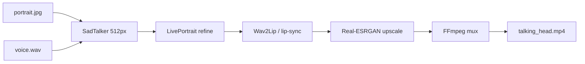

# Example 02 — Talking-head video on an 8 GB GPU

## Command

```bash
hermes run talking-head-video --photo portrait.jpg --audio voice.wav --profile 8gb-vram
```

## Output (truncated)

```text
✓ SadTalker 512px driving video
✓ LivePortrait refinement (--source-max-dim 512)
✓ Face animation rendered at 11.1x realtime
✓ Output: talking_head.mp4
```

## Before / After

- **Before**: a portrait and a recording — no video.
- **After**: a lip-synced talking-head clip, produced locally.
- **Note**: 8 GB VRAM is the tight constraint; the pipeline keeps each stage under it by processing
  4K only at the very end, frame by frame.

## Workflow


